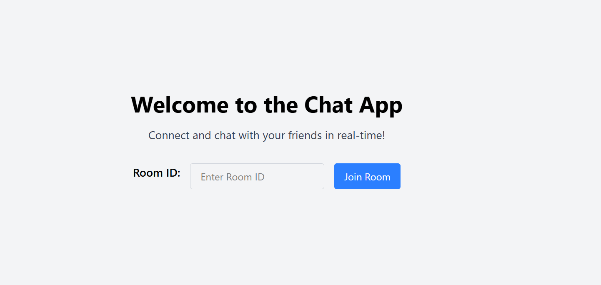
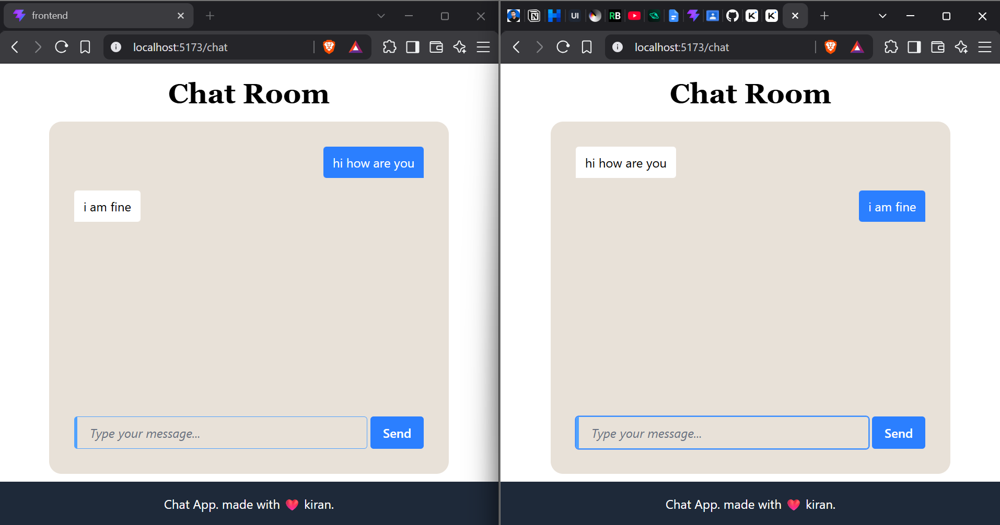

# 💬 ChatApp — Real-Time Room-Based Chat

A lightweight, real-time messaging application built with **React 19**, **TypeScript**, **Tailwind CSS**, and the **`ws`** WebSocket library. Users create or join a room using a Room ID and exchange messages instantly with everyone else in that room — no page refresh, no database, no accounts.

---

## 📸 Screenshots

<p align="center">
  
  &nbsp;&nbsp;
  
</p>

<p align="center"><i>Left: joining a room · Right: chatting inside a room</i></p>

---

## ✨ Features

- 🔗 **Room-based chat** — join any room with a custom Room ID
- ⚡ **Real-time messaging** — instant delivery over WebSockets
- 👥 **Multi-user support** — many clients can share a room
- 💬 **Live updates** — no refresh required
- 🎨 **Responsive UI** — clean interface styled with Tailwind CSS
- 🔄 **Persistent connection** — continuous two-way client/server communication

---

## 🏗️ Architecture

```
┌──────────────┐
│    Client    │
│  (React 19)  │
│  Join Room   │
│  Send Message│
└──────┬───────┘
       │ WebSocket (ws)
       ▼
┌────────────────────┐
│  WebSocket Server   │
│  (Node.js + ws)     │
│  Room Management    │
│  Message Routing    │
└─────────┬───────────┘
          │ Broadcast
          ▼
   ┌───────────────┐
   │ Users in Room │
   └───────────────┘
```

### Room logic

```
Room "general"          Room "random"
 ├── Client 1             ├── Client 4
 ├── Client 2             └── Client 5
 └── Client 3
```

Messages sent in a room are broadcast **only** to clients connected to that same room.

---

## 🗂️ Project Structure

```
chatapp/
├── backend/
│   ├── package.json
│   ├── tsconfig.json
│   └── src/
│       └── index.ts          # WebSocket server (port 8080)
│
├── frontend/
│   ├── index.html
│   ├── package.json
│   ├── vite.config.ts
│   ├── tsconfig.json
│   └── src/
│       ├── main.tsx           # React entry point
│       ├── App.tsx            # Routing & WebSocket connection
│       ├── App.css
│       ├── index.css          # Tailwind import
│       └── pages/
│           └── chat.tsx       # Chat room UI
│
├── screenshort/                # App screenshots (used above)
│   ├── roompage.png
│   └── chatroom.png
│
└── README.md
```

---

## 🛠️ Tech Stack

| Layer     | Technology                                |
|-----------|--------------------------------------------|
| Frontend  | React 19, TypeScript, Vite, Tailwind CSS   |
| Backend   | Node.js, TypeScript, `ws` (WebSocket)       |
| Routing   | React Router DOM v7                         |
| Build     | Vite (frontend), `tsc` (backend)            |

---

## 🚀 Getting Started

### Prerequisites

- [Node.js](https://nodejs.org/) v18+
- npm (bundled with Node.js)

### 1. Clone the repository

```bash
git clone https://github.com/kiran0094/chatapp.git
cd chatapp
```

### 2. Run the backend

```bash
cd backend
npm install
npm run dev
```

The WebSocket server starts on **port 8080**.

### 3. Run the frontend

In a new terminal:

```bash
cd frontend
npm install
npm run dev
```

The app runs at **http://localhost:5173** (default Vite port).

---

## 💻 Usage

1. Open the app in your browser.
2. Enter a **Room ID** (e.g. `general`, `random`, `team-alpha`).
3. Click **Join Room**.
4. Open the app in another tab or device and enter the **same Room ID**.
5. Start chatting in real time!

---

## 🔌 WebSocket Message Protocol

**Client → Server**

| Action    | Payload |
|-----------|---------|
| Join Room | `{ "type": "join", "payload": { "roomId": "general" } }` |
| Send Chat | `{ "type": "chat", "payload": { "message": "Hello!" } }` |

**Server → Client**

| Event             | Payload |
|-------------------|---------|
| Join Confirmation | `{ "status": "success", "message": "Joined room general" }` |
| Incoming Message  | `{ "status": "receiver", "message": "Hello!" }` |

---

## 🧠 Backend Overview (`backend/src/index.ts`)

Uses [`ws`](https://github.com/websockets/ws) to manage connections:

- Keeps an in-memory list of connected clients (`allSocket`) along with their `roomId`.
- On `"join"` — adds the client to the specified room.
- On `"chat"` — finds the sender's room and broadcasts the message to everyone else in it.
- Tracks the active user count.

## 🎨 Frontend Overview

- **`App.tsx`** — manages the global WebSocket connection, handles the join-room flow, and routes between the landing page (`/`) and the chat room (`/chat`).
- **`pages/chat.tsx`** — renders messages with distinct styling for sent vs. received, and supports sending via button or **Enter**.

---

## 🔐 Security Considerations

For production use, consider adding:

- ✅ Authentication & authorization
- ✅ Input validation & message size limits
- ✅ Rate limiting to prevent spam
- ✅ WSS (WebSocket Secure) over HTTPS
- ✅ Cleanup of disconnected clients
- ✅ Server-side validation of Room IDs

---

## 🎯 Future Improvements

- [ ] Usernames & user profiles
- [ ] Join/leave notifications
- [ ] Typing indicators
- [ ] Online user list
- [ ] Message timestamps
- [ ] Message history / persistence
- [ ] Private messaging (DMs)
- [ ] File & image sharing
- [ ] Auto-reconnection handling

---

## 📄 License

Open for educational and personal use.

---

Built with ❤️ by [kiran0094](https://github.com/kiran0094)